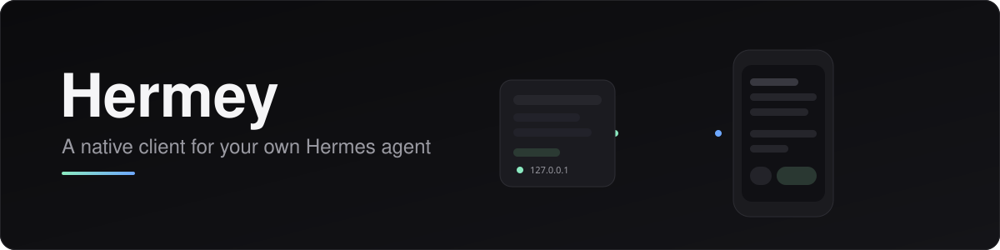

<p align="center">
  
</p>

<p align="center">
  <b>A native iOS and macOS client for your own Hermes agent.</b><br>
  Your bots, your machine, your network — no account, no cloud in the middle.
</p>

<p align="center">
  <a href="../../actions/workflows/ci.yml"></a>
  
  
  <a href="../../releases/latest"></a>
</p>

<!-- build:start -->
<p align="center"><sub>Latest published build <b>0.1.346</b> (build 346)</sub></p>
<!-- build:end -->

---

Hermes is an agent that runs on your own machine. Hermey is the phone and desktop client for it:
a bot list as the home screen, one endless conversation per bot, group chats, approvals, voice, and
attachments — talking to a small loopback service on your host over HTTPS on your tailnet.

There is no Hermey server. The host you already run is the backend; this repo is the client, the
bridge that adapts it, and the one command that installs the bridge.

## Quick start

**1. On your Hermes host** (Linux, root):

```bash
curl -fsSL https://github.com/macblizzard/hermey/releases/latest/download/install.sh | sudo bash
hermey pair
```

**2. On your phone or Mac**: install the app ([iOS](docs/APPS.md#ios) · [macOS](docs/APPS.md#macos)),
then scan the QR that `hermey pair` printed. For AltStore/SideStore, add the source
`https://github.com/macblizzard/hermey/releases/latest/download/altstore.json`.

That is the whole setup. The installer reuses the Hermes dashboard you already run, puts the bridge
on loopback, and exposes it with `tailscale serve` — a real certificate, reachable only from your
tailnet.

### Rather hand it to your agent?

Paste this into whatever agent has a root shell on your Hermes host:

> Set up a Hermey host on this machine. The repo is <https://github.com/macblizzard/hermey>; read
> `docs/FOR-AGENTS.md` and follow it exactly: install the bridge, verify `/v1/health` answers on both
> loopback and the tailnet URL, then give me the pairing code and the iOS/macOS install links. Don't
> change anything else on this host, and don't bind the bridge to a public interface.

[`docs/FOR-AGENTS.md`](docs/FOR-AGENTS.md) is a runbook written for an executor, not a reader: state
detection, the install command, two hard verification gates, the pairing handoff, the rules that keep
a host intact, and a symptom→cause→fix table for the failures that actually happen. [`llms.txt`](llms.txt)
has the same facts in the flat format documentation ingesters look for.

## What it does

| | |
|---|---|
| **Bots first** | The home screen is your bots. Each opens one endless conversation — no session list to manage. |
| **Group chats** | Several bots in one room, markdown rendered properly (tables, code, quotes), per-message read-aloud, copy, reply and reactions. |
| **Approvals in the app** | Tool approvals arrive as cards you can accept or reject, with the payload visible before you decide. |
| **Voice both ways** | Dictate a prompt, have a reply read aloud — through the host's STT/TTS so it works with the ringer switch off. |
| **Attachments** | Send images and files from the share sheet; the host sees a normal `@image:` reference. |
| **Native on both** | SwiftUI on iOS 17 and macOS 14: three-pane desktop shell, phone-shaped mobile chrome, dark theme, no web view anywhere. |

## How it works

```
 ┌──────────────┐   HTTPS (tailscale serve, real cert)   ┌────────────────┐
 │  iOS / macOS │ ─────────────────────────────────────► │  hermey-bridge │  127.0.0.1 only
 │  Hermey app  │   device ticket, single use, 30 s      │  FastAPI + WS  │
 └──────────────┘ ◄───────────────────────────────────── └───────┬────────┘
                                                                  │ loopback WS
                                                          ┌───────▼────────┐
                                                          │ Hermes dashboard│
                                                          │  (your agents)  │
                                                          └────────────────┘
```

The app never talks to Hermes directly. The bridge speaks the JSON-RPC that the Hermes dashboard
already exposes, and adds only what a client needs: pairing, per-device credentials, attachments and
voice. Details: [`docs/ARCHITECTURE.md`](docs/ARCHITECTURE.md).

## Security posture

- The bridge binds `127.0.0.1`. The only way in is `tailscale serve`, which terminates TLS with a
  real certificate — no public listener, no self-signed certificate, no port forward.
- Operator-only routes (pairing, writing into a bot's chat) are refused when a proxy header is
  present, so a tailnet peer cannot act as if it were the host.
- Pairing is a short numeric code minted on the host, redeemed once for a device key pair. Every
  request carries a single-use 30-second bearer ticket; a leaked log is worthless.
- Devices are individually revocable, and revoking one does not disturb the others.
- The apps store their private key in the Keychain; nothing is written to `UserDefaults`. An unsigned
  Mac build has no keychain entitlement, so it also keeps the same item in a `0600` file under
  `~/Library/Application Support/Hermey/` (excluded from backups) — Settings → Host says which tier
  holds it.

Read [`SECURITY.md`](SECURITY.md) for the threat model and how to report a problem.

## Requirements

- A host running Hermes with Python 3.11+, systemd, and Tailscale (for the default exposure).
- iOS 17+ or macOS 14+.
- No Apple developer account is needed to *run* it — see [`docs/APPS.md`](docs/APPS.md) for the
  sideload path and its re-signing caveat.

## Documentation

| | |
|---|---|
| [`docs/INSTALL.md`](docs/INSTALL.md) | What the installer does, all flags, uninstall, moving hosts |
| [`docs/APPS.md`](docs/APPS.md) | Installing the iOS and macOS builds, first run, re-signing |
| [`docs/ARCHITECTURE.md`](docs/ARCHITECTURE.md) | The protocol, the components, the state on disk |
| [`docs/TROUBLESHOOTING.md`](docs/TROUBLESHOOTING.md) | `hermey doctor`, common failures, and what each one means |
| [`docs/SECURITY.md`](docs/SECURITY.md) | Threat model, device model, what the bridge will not do |
| [`docs/UI-PITFALLS.md`](docs/UI-PITFALLS.md) | Hard-won UI rules, if you are changing the app |
| [`docs/FOR-AGENTS.md`](docs/FOR-AGENTS.md) | The install as a runbook an agent can execute, end to end |
| [`llms.txt`](llms.txt) | The repo in the flat, machine-readable index format |
| [`setup/SKILL.md`](setup/SKILL.md) | The same install packaged as a Hermes agent skill |

## Development

Everything builds on GitHub-hosted macOS runners, so no local Xcode is required to validate a change.

```bash
# Swift packages (protocol, design system, renderer, app state)
swift build && swift test

# Bridge (Python 3.11+)
python3 -m venv .venv && .venv/bin/pip install -e "Bridge/[test]"
.venv/bin/pytest Bridge/tests

# Generate the Xcode projects (they are never committed)
brew install xcodegen && xcodegen generate
```

CI runs the packages, both apps, the unsigned `.ipa`, the bridge tests and a QA harness on every
push. See [`CONTRIBUTING.md`](CONTRIBUTING.md).

## Status

Working and in daily use on iOS and macOS. The apps are unsigned: the iOS build is installed through
AltStore/SideStore with your own signing certificate, and the macOS build opens with a right-click →
Open the first time. Notarization and TestFlight are deliberately out of scope until there is an
Apple developer account behind them — the honest cost is documented in [`docs/APPS.md`](docs/APPS.md).

## License

MIT — see [`LICENSE`](LICENSE).
