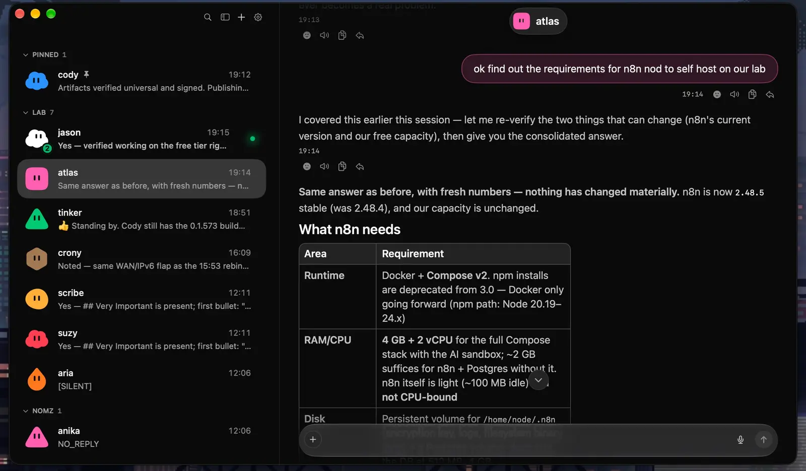
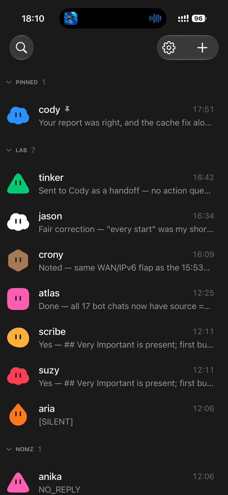
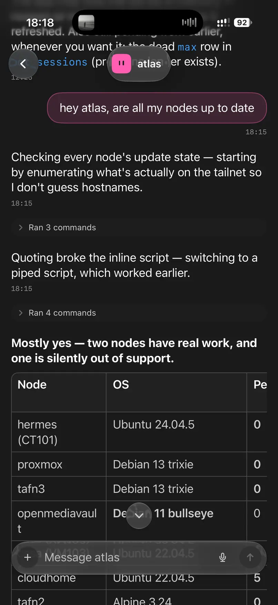
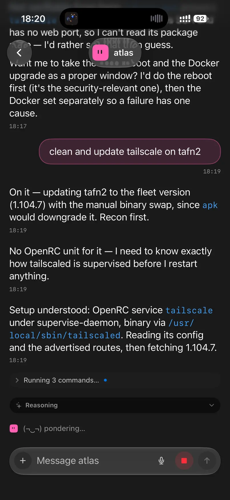
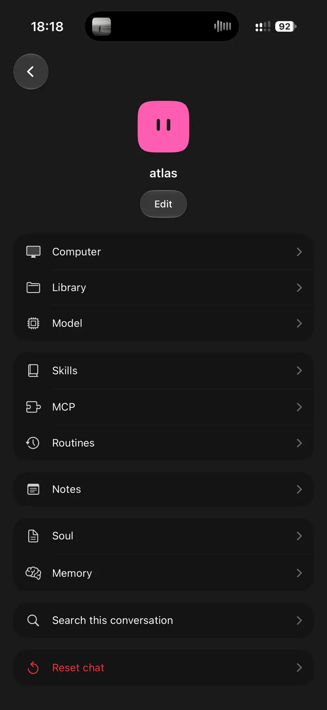
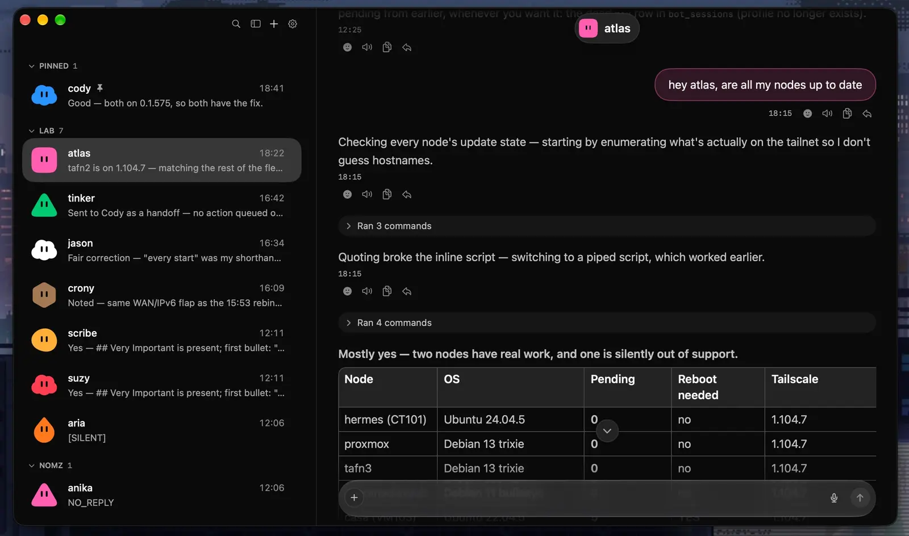
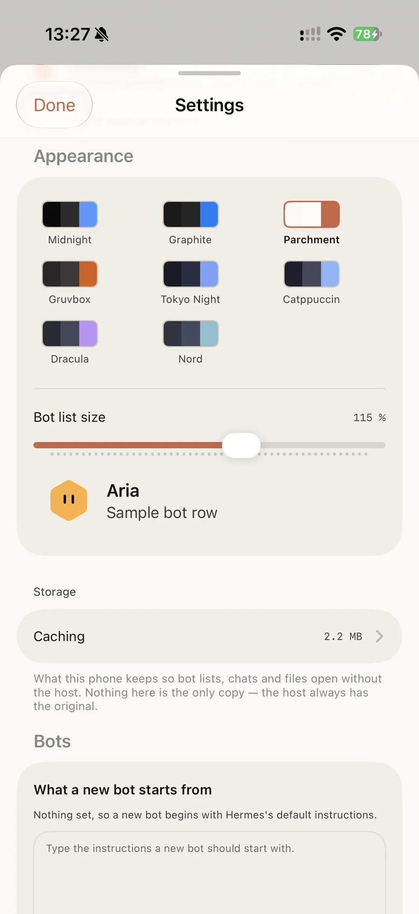
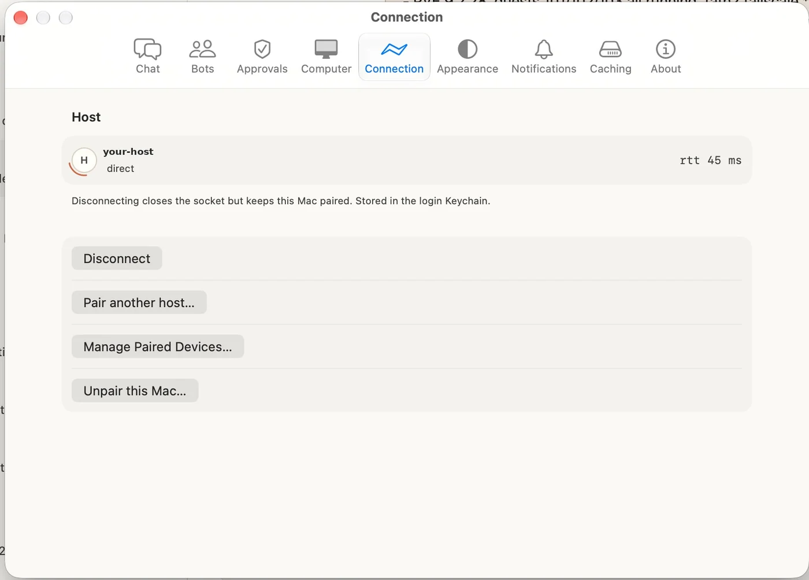

<p align="center">
  
</p>

<p align="center">
  <b>A native iOS and macOS client for your own Hermes agent.</b><br>
  Your bots, your machine, your network — no account, no cloud in the middle.
</p>

> **Hermey is an independent project** — not affiliated with, endorsed by, or supported by the Hermes
> project or its maintainers. "Hermes" is named only to say what Hermey connects to. Start with
> [`docs/PREREQUISITES.md`](docs/PREREQUISITES.md) and please don't ask the Hermes maintainers for support
> with Hermey.

<p align="center">
  <a href="../../actions/workflows/ci.yml"></a>
  
  
  <a href="../../releases/latest"></a>
</p>

---

Hermes is an agent that runs on your own machine, and Hermey is the phone and desktop client for it:
a bot list as the home screen, one endless conversation per bot, group chats, approvals, voice,
attachments — and, on the Mac, a computer a bot can use when you say so.

**Hermes has to be installed already.** Hermey is a client plus one host service; it does not install,
upgrade or manage Hermes, and its own documentation is the authority on getting the engine running.
What Hermey adds is `hermeyd`, a single Rust binary that pairs devices, mints 30-second tickets,
relays the engine's WebSocket and serves the apps' `/v1` API — plus its systemd unit (launchd on
macOS). There is no Hermey server and no Hermey account: the apps dial `hermeyd` directly over HTTPS
on your tailnet.

There are two ways to install that service, and both end with the same `hermeyd` installed:

- **prebuilt** — the installer at
  `https://github.com/macblizzard/hermey/releases/latest/download/install.sh` downloads the release
  artifact for your platform, verifies it against the published `SHA256SUMS`, and installs
  `/opt/hermey/bin/hermeyd`;
- **from source** — `sudo setup/install.sh --from-source` (the repo copy of the same script) compiles
  it with cargo, for a platform with no published build or a host that will not run a download.

## Quick start

**1. On your Hermes host** (Linux or macOS, root):

```bash
curl -fsSL https://github.com/macblizzard/hermey/releases/latest/download/install.sh | sudo sh
tailscale serve --bg http://127.0.0.1:8788     # optional but recommended
sudo hermeyd pair      # prints a 6-digit code, a pairing URL (https://<host>/?code=…) and a QR to scan
```

The installer downloads the `hermeyd` binary for this platform, checks its published SHA-256, installs
it under `/opt/hermey/bin`, creates `/var/lib/hermeyd`, writes `/etc/hermey/hermeyd.env`, installs the
systemd unit (or prints the launchd commands) and puts the `hermes-genui` plugin into your engine's
plugin directory. `--from-source` builds with cargo instead. Details and every flag:
[`docs/INSTALL.md`](docs/INSTALL.md).

**2. On your phone or Mac**: install the app ([iOS](docs/APPS.md#ios) · [macOS](docs/APPS.md#macos)),
then enter the pairing code against this host's tailnet name — or scan the QR `hermeyd pair` drew. For AltStore/SideStore, add the source
`https://github.com/macblizzard/hermey/releases/latest/download/altstore.json`.

That is the whole setup. hermeyd listens on `127.0.0.1:8788` only, and `tailscale serve` gives it a
real certificate reachable only from your tailnet. The engine it relays to must be started with
`hermes serve --isolated`: Hermes allows one gateway per `HERMES_HOME`.

### Rather hand it to your agent?

Paste this into whatever agent has a root shell on your Hermes host:

> Set up a Hermey host on this machine. The repo is <https://github.com/macblizzard/hermey>; read
> `docs/FOR-AGENTS.md` and follow it exactly: install hermeyd, verify `/v1/health` answers on both
> loopback and the tailnet URL, then give me the pairing code and the iOS/macOS install links. Don't
> change anything else on this host, and don't bind hermeyd to a public interface.

[`docs/FOR-AGENTS.md`](docs/FOR-AGENTS.md) is a runbook written for an executor, not a reader: state
detection, the install command, two hard verification gates, the pairing handoff, the rules that keep
a host intact, and a symptom→cause→fix table for the failures that actually happen. [`llms.txt`](llms.txt)
has the same facts in the flat format documentation ingesters look for.

### Documentation site

The same material, laid out for reading: **<https://macblizzard.github.io/hermey/docs/>** — install,
the apps, computer use, the agent runbook, troubleshooting, the threat model and a reference page, with
search. It is generated from this directory by `Tools/site/build_docs.py`, so the files here remain the
authority; rebuild it with:

```bash
python3 Tools/site/build_docs.py <the docs/ directory of the gh-pages branch>
```

## Screenshots

<p align="center">
  
  
  
  
</p>
<p align="center"><sub>Bot list · a markdown answer · folded tool runs · per-bot settings — iPhone</sub></p>

<p align="center">
  
</p>
<p align="center"><sub>The Mac window gives a wide answer the room it needs.</sub></p>

<p align="center">
  
  
</p>
<p align="center"><sub>The light theme, <b>Parchment</b>, on both apps.</sub></p>

## What it does

| | |
|---|---|
| **Bots first** | The home screen is your bots. Each opens one endless conversation — no session list to manage. |
| **Group chats** | Several bots in one room, with tables, code and quotes rendered, per-message read-aloud, copy, reply and reactions. |
| **Approvals in the app** | Tool approvals arrive as cards you can accept or reject, with the payload visible before you decide. |
| **The Mac as a computer** | Full-screen computer use: a paired Mac runs commands, clicks, types and shares a workspace, with one sorted queue and a per-grant status row. |
| **Sign-in cards** | When a bot needs a password, it raises a card naming the site and fields; the value goes to the page and never to the model, the transcript or a log. |
| **Integrations** | Eight services through your own Composio key — Gmail, Calendar, Drive, Docs, Sheets, Maps, Cloudflare, Vercel — with several accounts per service, each named. |
| **Routines and notes** | A bot's scheduled jobs and notes are readable and editable from the app, not just from a shell. |
| **Backup, import and export** | Export every bot's soul, memory, notes and routines as one file; restore additively on another host, or import bots from another platform. |
| **Voice both ways** | Dictate a prompt, have a reply read aloud — through the host's STT/TTS so it works with the ringer switch off. |

## How it works

```
 ┌──────────────┐   HTTPS (tailscale serve, real cert)   ┌────────────────┐
 │  iOS / macOS │ ─────────────────────────────────────► │    hermeyd    │  127.0.0.1:8788
 │  Hermey app  │   device ticket, single use, 30 s      │    Rust + WS   │  (+ 8790 browsers)
 └──────────────┘ ◄───────────────────────────────────── └───────┬────────┘
                                                                  │ ws://127.0.0.1:9121/api/ws
                                                          ┌───────▼────────┐
                                                          │ Hermes engine  │
                                                          │  (your agents) │
                                                          └────────────────┘
```

The app never talks to Hermes directly. hermeyd relays the engine's JSON-RPC WebSocket and adds only
what a client needs: pairing, per-device credentials, attachments, generated-UI cards and voice. Details: [`docs/ARCHITECTURE.md`](docs/ARCHITECTURE.md).

## Security posture

- hermeyd binds `127.0.0.1` (API on `8788`, browser channel on `8790`) and refuses any other bind. The only way in is `tailscale serve`, which terminates TLS with a
  real certificate — no public listener, no self-signed certificate, no port forward.
- Writes into a bot's conversation are refused when a proxy header (`forwarded`, `x-forwarded-for`,
  `x-real-ip`, `tailscale-user-login`) is present, so a tailnet peer cannot act as if it were the
  host. Pairing codes are minted only for a loopback peer and redeemed once; the service refuses any
  bind but loopback, so there is no proxied path to reach that route at all.
- Pairing is a short numeric code minted on the host, redeemed once for a device key pair. Every
  request carries a single-use 30-second bearer ticket; a leaked log is worthless.
- Devices are individually revocable, and revoking one does not disturb the others.
- The apps store their private key in the Keychain; nothing is written to `UserDefaults`. An unsigned
  Mac build has no keychain entitlement, so it also keeps the same item in a `0600` file under
  `~/Library/Application Support/Hermey/` (excluded from backups) — Settings → Host says which tier
  holds it.

Read [`SECURITY.md`](SECURITY.md) for the threat model and how to report a problem.

## Requirements

- **A host already running Hermes**, with an engine home whose `profiles/` directory is readable —
  usually `~/.hermes` or `$HERMES_HOME`. Hermey reads that directory; it does not create it.
- **Linux with systemd, or macOS with launchd**, and `sudo` either way: the installer writes `/opt`,
  `/etc` and `/var/lib`. `hermeyd` must run as the engine's owner.
- **Tailscale, recommended but optional.** It gives the service a certificate and a tailnet address.
  Without it `hermeyd` is reachable only from the host itself — enough to verify, not enough to pair
  a phone.
- **One gateway per `HERMES_HOME`.** Run the engine for this home with `hermes serve --isolated`;
  `hermeyd --gateway-check` exits `75` if another gateway already owns it.
- iOS 17+ or macOS 14+.
- No Apple developer account is needed to *run* it — see [`docs/APPS.md`](docs/APPS.md) for the
  sideload path and its re-signing caveat.

## Documentation

| | |
|---|---|
| [`docs/PREREQUISITES.md`](docs/PREREQUISITES.md) | What Hermes has to be doing first, then install, publish, pair |
| [`docs/INSTALL.md`](docs/INSTALL.md) | What the installer writes, every flag, uninstall, when the first install fails |
| [`docs/HERMEYD.md`](docs/HERMEYD.md) | The host service: its contract, its routes, its tests |
| [`docs/APPS.md`](docs/APPS.md) | Installing the iOS and macOS builds, first run, re-signing |
| [`docs/ARCHITECTURE.md`](docs/ARCHITECTURE.md) | The protocol, the components, the state on disk |
| [`docs/TROUBLESHOOTING.md`](docs/TROUBLESHOOTING.md) | Common failures and what each one means |
| [`docs/SECURITY.md`](docs/SECURITY.md) | Threat model, device model, what hermeyd will not do |
| [`docs/CREDENTIALS.md`](docs/CREDENTIALS.md) | Login cards: a secret reaches the page without the bot ever seeing it |
| [`docs/INTEGRATIONS.md`](docs/INTEGRATIONS.md) | Eight services through your own Composio key, several named accounts each |
| [`docs/IMPORT-FROM-ANOTHER-PLATFORM.md`](docs/IMPORT-FROM-ANOTHER-PLATFORM.md) | Bringing bots in from another platform |
| [`docs/UI-PITFALLS.md`](docs/UI-PITFALLS.md) | UI rules to follow if you are changing the app |
| [`docs/FOR-AGENTS.md`](docs/FOR-AGENTS.md) | The install as a runbook an agent can execute, end to end |
| [`llms.txt`](llms.txt) | The repo in the flat, machine-readable index format |
| [`setup/SKILL.md`](setup/SKILL.md) | The same install packaged as a Hermes agent skill |

## Development

Everything builds on GitHub-hosted macOS runners, so no local Xcode is required to validate a change.

```bash
# Swift packages (protocol, design system, renderer, app state)
swift build && swift test

# Host service (Rust)
cd hermeyd && cargo test && cargo build --release

# Generate the Xcode projects (they are never committed)
brew install xcodegen && xcodegen generate
```

CI runs the packages, both apps, the unsigned `.ipa`, the host service's Rust tests and a QA harness
on every push. See [`CONTRIBUTING.md`](CONTRIBUTING.md).

## Status

Working and in daily use on iOS and macOS. The apps are unsigned: the iOS build is installed through
AltStore/SideStore with your own signing certificate, and the macOS build opens with a right-click →
Open the first time. Notarization and TestFlight are deliberately out of scope until there is an
Apple developer account behind them — the honest cost is documented in [`docs/APPS.md`](docs/APPS.md).

## License

MIT — see [`LICENSE`](LICENSE).
